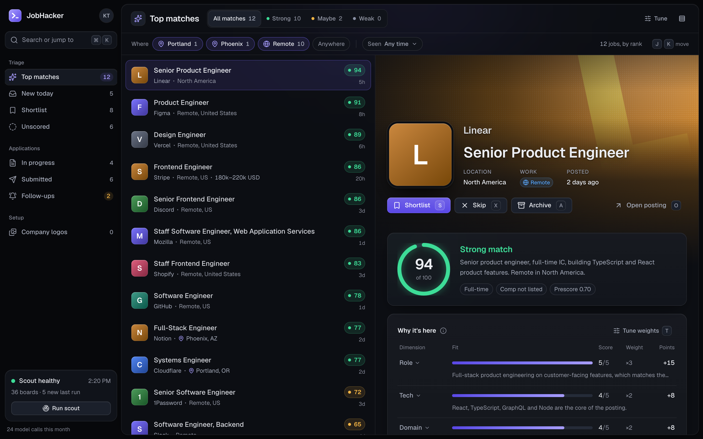

# JobHacker

**Live demo:** [https://jobhacker.space/](https://jobhacker.space/) — a fictional candidate and sample jobs. Nothing you do there is saved or sent.

A **local-first, single-user** job-search assistant. It discovers postings from public ATS
boards (Greenhouse, Lever, Ashby, SmartRecruiters, Breezy, Polymer) and optional search
sources (JSearch with your own key, Hacker News "Who is hiring"), ranks them against your
criteria, prepares tailored application materials, and fills application forms **in your own
Chrome** — so you review and click **Submit** yourself.



More of the interface is in [docs/screenshots](docs/screenshots/README.md). These pictures are the running app with sample data, not a live search. On the demo, Open & fill replays a recorded run of the real form filler on a sample form.

It is built to be safe by design:

- **It never submits an application.** It only fills fields; you submit every one.
- **It never invents facts about you.** Every resume bullet and answer is grounded in
  `config/profile.yaml`; missing info is left as a visible `[NEEDS INPUT: …]` marker.
- **It stays polite and local.** Public JSON endpoints only (no scraping/bot-evasion), ≤1
  request/second per host, and your profile, database, and output stay on your machine. The
  only exception is the model calls that score jobs and write materials, which go to Anthropic
  with your own API key.

> **Project status:** pre-v1, built for one person's job search and shared as-is. Expect
> rough edges. If you are an agent working on this, start at `AGENTS.md`.

---

## What's worth a look

If you're here to read the code rather than run it:

- **It can't submit.** Every browser action goes through `src/core/apply/safe-page.ts`, which
  has no submit method and refuses to click anything that reads as submit, apply or send.
  `src/core/apply/guard.test.ts` fails the build if any other apply file touches the page directly.
- **It can't make things up.** `src/core/prep/grounding.ts` rejects a tailored resume bullet that
  doesn't trace to a real profile bullet, or that adds a number or a technology the source
  doesn't have. Self-identification answers come only from the profile, through a deterministic
  mapper (`src/core/apply/self-id.ts`). The model never sees those fields.
- **Model output is untrusted input.** Every response is parsed against a Zod schema, retried
  once with the errors, then recorded as a failure (`src/core/llm/types.ts`).
- **No job disappears silently.** Four gates are the only exclusions. Everything else is a scored
  dimension, and `pnpm cli funnel` and `pnpm cli why <jobId>` account for every job.
- **Layering.** All logic lives in `src/core` and takes its dependencies as parameters. The
  Next.js app and the CLI are thin layers over it. `docs/ARCHITECTURE.md` walks through it.
- **Tests.** About 900 Vitest tests run against recorded fixtures and a fake model, never
  the network.

---

## Requirements

- **macOS, Windows or Linux**
- **Node.js 22+** and **pnpm 9+** (`corepack enable` will provide pnpm). If `pnpm install` can't
  download a prebuilt `better-sqlite3` for your machine, it compiles one, which needs build
  tools: Visual Studio Build Tools ("Desktop development with C++") on Windows, or
  `build-essential` and `python3` on Linux.
- **Google Chrome or Chromium** — for filling forms and rendering the resume PDF. JobHacker looks
  in the usual install folders. If yours is elsewhere, set `JOBHACKER_CHROME_PATH` in `.env`.
- An **Anthropic API key** — only needed for LLM scoring and writing materials

---

## 1. Install

```sh
pnpm install
```

## 2. Configure

All real config lives in `config/*.yaml` and `.env`, and all of it is **gitignored** — it
never gets committed. Copy the examples and edit them:

```sh
cp config/profile.example.yaml   config/profile.yaml
cp config/criteria.example.yaml  config/criteria.yaml
cp config/preferences.example.md config/preferences.md
cp config/companies.example.yaml config/companies.yaml
cp .env.example                  .env
```

On Windows, in PowerShell:

```powershell
Copy-Item config/profile.example.yaml   config/profile.yaml
Copy-Item config/criteria.example.yaml  config/criteria.yaml
Copy-Item config/preferences.example.md config/preferences.md
Copy-Item config/companies.example.yaml config/companies.yaml
Copy-Item .env.example                  .env
```

The example criteria names two places, Portland and Phoenix, plus Remote. Replace them with
your own in `config/criteria.yaml` (see `docs/reference/PLACES.md`).

| File | What it is |
|---|---|
| `config/profile.yaml` | **The only source of truth about you** — contact, experience bullets (with stable `id`s), skills, standard answers. Fill it in with facts you can stand behind. |
| `config/preferences.md` | **What you want, in your own words**: roles, places, pay, what excites you, dealbreakers. The scoring model reads it as prose; the prescore uses lexical terms only to order spend, never to exclude. Editing it re-scores jobs on the next score run. |
| `config/criteria.yaml` | Mechanical settings only: the hard gates (`max_age_days`, `company_blocklist`), six ranking weights, strong/maybe bands, the per-run scoring cap (`max_new_scores_per_run`) and models. The compatibility `prescore_floor` field must stay `0` until removed from the schema. Have a v1 file with title/location keyword lists? Run `pnpm cli config:migrate`: it keeps the old file as `criteria.v1.yaml` and drafts `preferences.md` from your keywords. |
| `config/companies.yaml` | The ATS boards to scout. Add one easily with `pnpm cli companies:add <careers-url>` (it detects the ATS and verifies the board). |
| `.env` | `ANTHROPIC_API_KEY=…` (required for scoring/prep). Optional: `DATABASE_PATH`, `JOBHACKER_CHROME_PATH` (where Chrome is, if it isn't found), `JOBHACKER_CDP_ENDPOINT` (the dedicated Chrome's debugging address, `http://127.0.0.1:9222` by default), and the search-source keys listed in `.env.example`. |

**Editing in the app.** Once the app is running (`pnpm dev`), Setup → **Settings** edits
`profile.yaml` (Profile, Answers, Self-ID) and `preferences.md` (Preferences). Each section saves
on its own, is validated first, and changes only its own lines, so your comments stay. The previous
file is copied to `data/backups/config/` before each save. An edit that would re-score your jobs
(summary, skills, experience or preferences) says how many scores go stale, and roughly what
re-scoring costs, before it saves. A save is refused while a scout or score run is going.
Hand-editing the files still works. Settings reads them fresh each time a page loads, and a save
rewrites only its own section, so a hand edit elsewhere in the file survives. Reload the page after
hand-editing a section, or saving that section in the app writes what the page showed.

Each example file documents its own schema inline. Validate your config any time with:

```sh
pnpm cli config:check
```

### Build the real profile locally

Instead of hand-copying a resume, put a PDF or DOCX at `input/resume.pdf|docx` and unzip
LinkedIn's full archive under `input/linkedin/`. The whole `input/` tree is gitignored.
Raw files are parsed locally and are never logged or sent to an LLM.
If you have both formats, prefer DOCX because it preserves section and bullet reading order; use
`pnpm cli profile:build --resume input/your-resume.docx` for a differently named file.

```sh
pnpm cli profile:build
pnpm cli profile:check
```

`profile:build` writes `config/profile.draft.yaml` and an ignored source report; it never
overwrites `profile.yaml`. Review every claim against its named source, resolve every conflict
marker, rerun `profile:check`, then rename the draft to `profile.yaml` yourself. Missing facts and
standard answers remain visible as `[NEEDS INPUT: …]` instead of being guessed.

## 3. Initialize the database

```sh
pnpm cli db:migrate
```

This creates `data/jobhacker.db` (SQLite, also gitignored). Run it once before the first scout,
and again after pulling changes that add migrations.

## 4. First run

```sh
pnpm cli scout     # fetch boards → upsert → gate → prescore → LLM-score (uses your API key)
pnpm cli rank      # the ranked list, best first, with the six dimension scores
pnpm dev           # start the review UI at http://localhost:3000
```

`scout` discovers and scores jobs. The UI is where you triage, prep and track them.
Only four things ever exclude a job: closed, duplicate, blocklisted company, or older than `max_age_days` (`0` = off). Everything else is a scored dimension, so nothing disappears silently. `pnpm cli funnel` shows where every job went, and `pnpm cli why <jobId>` explains one job.
Scoring spends in prescore order up to `max_new_scores_per_run`. Jobs it doesn't reach stay visible on the **Unscored** tab, and the next `pnpm cli score` continues where it stopped.
To try discovery **without** spending anything on the LLM, use `pnpm cli scout --no-score`.
The weight sliders on the queue page re-rank instantly with no LLM calls. "Save to criteria.yaml" keeps the weights. Critical role/seniority/logistics scores cap impossible jobs below the relevant verdict band without hiding them.

---

## Daily workflow

1. **Scout** runs (manually via `pnpm cli scout`, or on a schedule — see below).
2. **Triage** the queue at http://localhost:3000 — keyboard-friendly: shortlist / skip / archive.
3. **Prep** a shortlisted job — generates a tailored resume, cover note, and answers.
4. **Open & fill**: launch your dedicated Chrome and let it fill the form.
5. **Review and submit yourself.** The tool never clicks Submit.
6. **Mark submitted** in the UI.
7. **Track** outcomes, notes, and follow-ups on the **Applications** page.

For the apply step you run a dedicated Chrome with remote debugging once per session:

```sh
pnpm cli chrome    # launches the dedicated Chrome profile for apply-assist
```

Press `?` in the app for the keyboard shortcuts. They show ⌘ as on a Mac; on Windows and Linux
use Ctrl instead (Ctrl+K opens search).

---

## Command reference

Run any of these with `pnpm cli <command>`.

| Command | What it does |
|---|---|
| `config:check` | Validate `config/*.yaml` and `preferences.md` and exit |
| `config:migrate` | Convert a v1 keyword `criteria.yaml` to v2 and draft `preferences.md` from it (`--force` overwrites an existing draft) |
| `profile:build` | Parse a local resume + LinkedIn export into a sourced `profile.draft.yaml` without overwriting `profile.yaml` |
| `profile:check` | Report sourced/changed bullets, input hashes, skills, conflicts, and `NEEDS INPUT` markers |
| `db:migrate` | Apply pending database migrations |
| `db:info` | Print table row counts |
| `companies:add <url>` | Detect an ATS careers URL, verify the board, append it to `companies.yaml` |
| `scout` | Fetch active boards, upsert jobs, gate, prescore, and score (`--no-score` to skip the LLM) |
| `score` | Gate, prescore and score the existing jobs without re-fetching boards (`-l <n>` lowers the cap) |
| `funnel` | Count every job: gated (per gate) → passed → LLM-scored (by band) → unscored by exact defer/error state. No LLM. |
| `rank` | Print the ranked list (`--n 30`, `--verdict strong\|maybe\|no`). No LLM. `jobs:top` is an alias |
| `why <jobId>` | Explain one job: gate, prescore terms, and each dimension × weight with its reason. No LLM |
| `prep <jobId>` | Generate tailored resume, cover note, and answers for one job |
| `chrome` | Launch the dedicated Chrome profile for apply-assist |
| `apply <jobId>` | Open an application form in Chrome and fill it (**never submits**) |
| `applications:list` | List every application with status and follow-up date |
| `applications:due` | List applications whose follow-up is due now |
| `applications:status <jobId> <status>` | Change status (`prepped\|submitted\|interviewing\|offer\|rejected\|withdrawn\|ghosted`) |
| `applications:export [file]` | Export all applications as CSV (file, or stdout if omitted) |
| `backup` | Copy the database to a timestamped file under `data/backups/` |

---

## Tracker

The **Applications** page lists every application with its status, submitted and follow-up
dates, and a **Follow-ups due** view. On an individual application page you can change the
status, set a follow-up date, keep notes, and read the full event timeline. Export the whole
table with the **Export CSV** link, or `pnpm cli applications:export [file]`.

## Backup

`pnpm cli backup` copies the SQLite database to `data/backups/jobhacker-<timestamp>.db` using
SQLite's online backup, so it is safe to run while the app is in use.

## Logs

The CLI writes a daily JSON log to `data/logs/jobhacker-YYYY-MM-DD.log` (in addition to stdout)
and prunes logs older than 14 days on each run. A `.env` file in the repo root is loaded
automatically (your real environment always wins), so `ANTHROPIC_API_KEY` can live there.

## Scheduling (optional)

> You don't need this to use the tool — it only automates the `scout` step. Set it up once
> you're happy running scout by hand.

Run scout unattended with **launchd** (recommended on macOS):

1. Copy the template: `cp ops/space.jobhacker.scout.plist ~/Library/LaunchAgents/`.
2. In the copy, replace `__REPO__` with the absolute path to this checkout and `__PNPM__`
   with the output of `which pnpm`; set the Hour/Minute you want (default 07:30).
   Both must be absolute. The plist puts that pnpm's directory on `PATH` before running
   it, because launchd does not load your shell profile and pnpm needs the `node` that
   sits next to it. It also creates `data/logs` itself before writing there.
3. Load it:
   ```sh
   launchctl bootstrap gui/$(id -u) ~/Library/LaunchAgents/space.jobhacker.scout.plist
   launchctl list | grep jobhacker      # shows the label space.jobhacker.scout
   ```
   Run once immediately: `launchctl kickstart gui/$(id -u)/space.jobhacker.scout`.
   Remove it: `launchctl bootout gui/$(id -u) ~/Library/LaunchAgents/space.jobhacker.scout.plist`.

On **Linux**, or as an alternative on macOS, use **cron** (`crontab -e`) — daily at 07:30:

```cron
30 7 * * * mkdir -p /ABSOLUTE/PATH/TO/REPO/data/logs && cd /ABSOLUTE/PATH/TO/REPO && export PATH="$(dirname /ABSOLUTE/PATH/TO/pnpm):$PATH" && /ABSOLUTE/PATH/TO/pnpm cli scout >> data/logs/cron.log 2>&1
```

On **Windows**, use **Task Scheduler**: Create Basic Task, pick Daily and the time you want, then
Start a program. Program: `cmd.exe`. Arguments: `/c pnpm cli scout`. Start in: the full path to
this folder. Scout writes its own log to `data\logs\`.

Scout exits non-zero on failure, and its last-run status appears in the UI header.

---

## For developers

- `pnpm check` — typecheck + lint (Biome) + tests (Vitest); must be green.
- `pnpm build` / `pnpm start` — production build and serve of the review UI.
- `pnpm db:generate` — create a new Drizzle migration after a schema change.
- `AGENTS.md` has the invariants every change must keep. `docs/ARCHITECTURE.md` describes
  the system as built, and `docs/reference/` holds the specs for sources, places and the UI
  kit. `src/core` holds all logic and never imports from `src/app` or `src/cli`.
- `ui-reference/prototype.html` is the visual spec: open it in a browser. Its source is in
  `ui-reference/prototype-src/`, and its reference frames are in `ui-reference/screens/`.

## How it was built

JobHacker was built by AI coding agents, one scoped round at a time, each checked by a second
agent and then tested by hand. Comments and docs refer to rounds as J1, J2, … and to decisions
as D1, D2, …; those planning docs stay in the private repo, and nothing here depends on them.
"Kris" in comments is the original user. The test fixtures and the prototype's sample data use
a fictional candidate, Kris Tester.

## License

MIT. See `LICENSE`.
