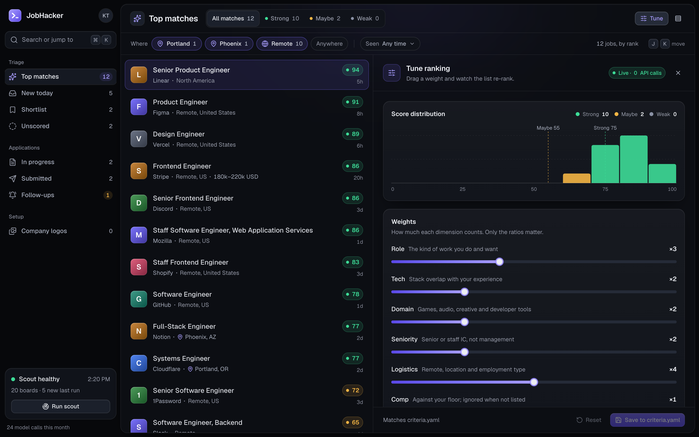
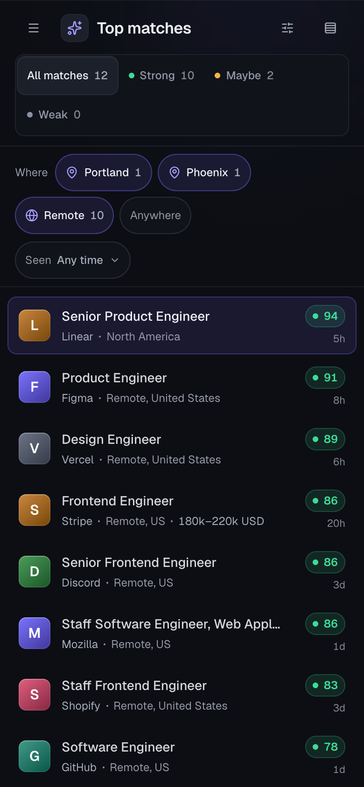

# Screenshots

The triage view is at the top of the README, because that is the picture GitHub shows on the repository home. This page holds the rest, so the README can stay a setup guide.

A wiki would split the pictures from the commit that produced them. `docs/testing/screenshots/` is the other place screenshots already go, and it is gitignored on purpose: those frames are taken against the live database and can show a real search. Nothing in this folder should. When these need retaking, run the app against a throwaway database and the example config, and read every frame before replacing it.

These pictures are the running app. The companies are public, the candidate is the fictional one in `config/profile.example.yaml`, and the places in the filter are the example criteria. The marks are the monogram the app draws when a logo image has not loaded. In ordinary use the browser loads the logo from Brandfetch once a domain is known.

## Tune the ranking

Moving a weight re-ranks the queue on this machine. It does not call the model.

## On a phone

