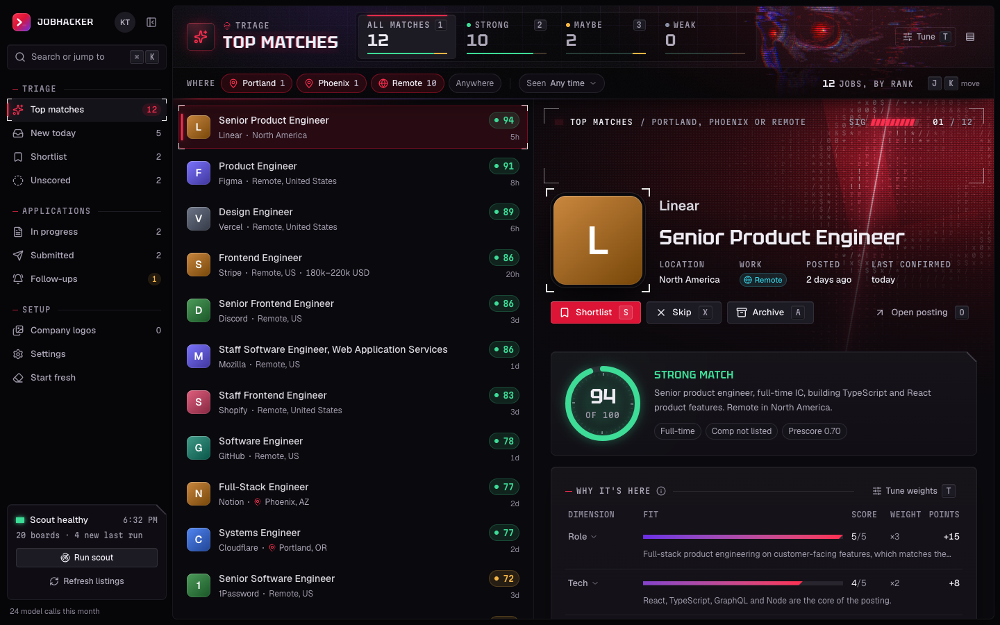
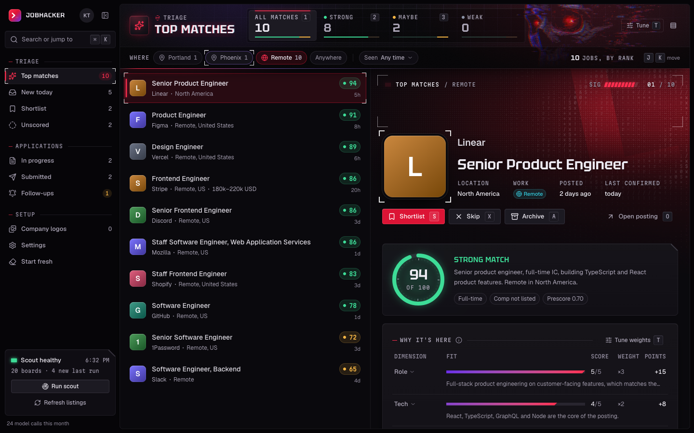
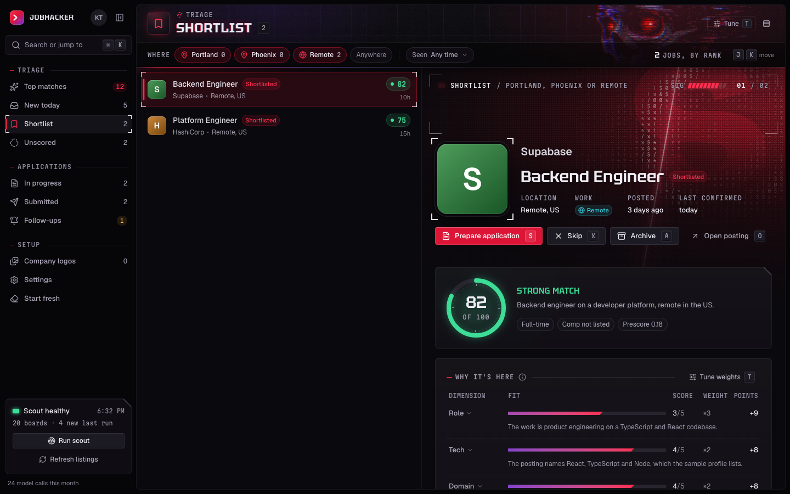
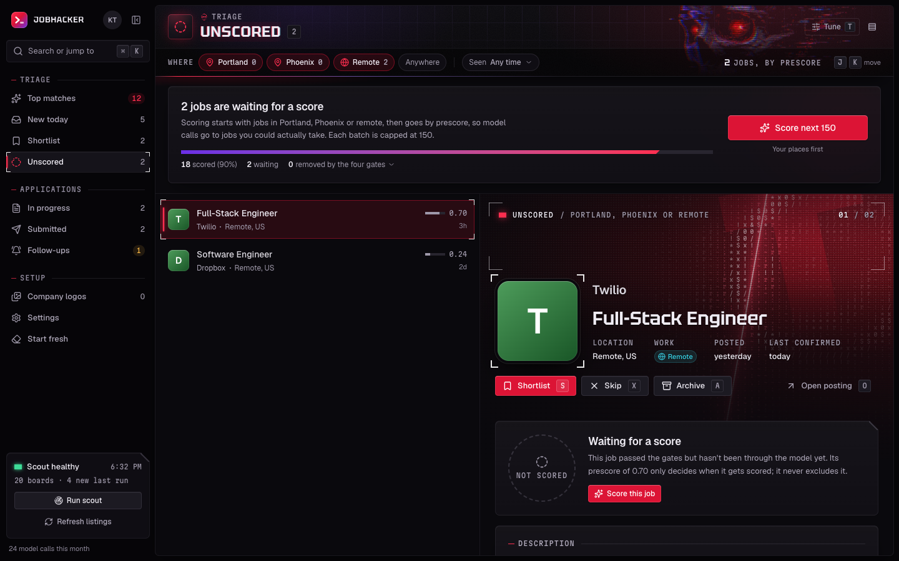
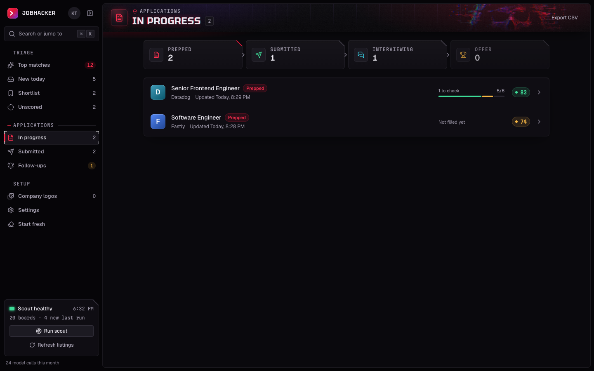
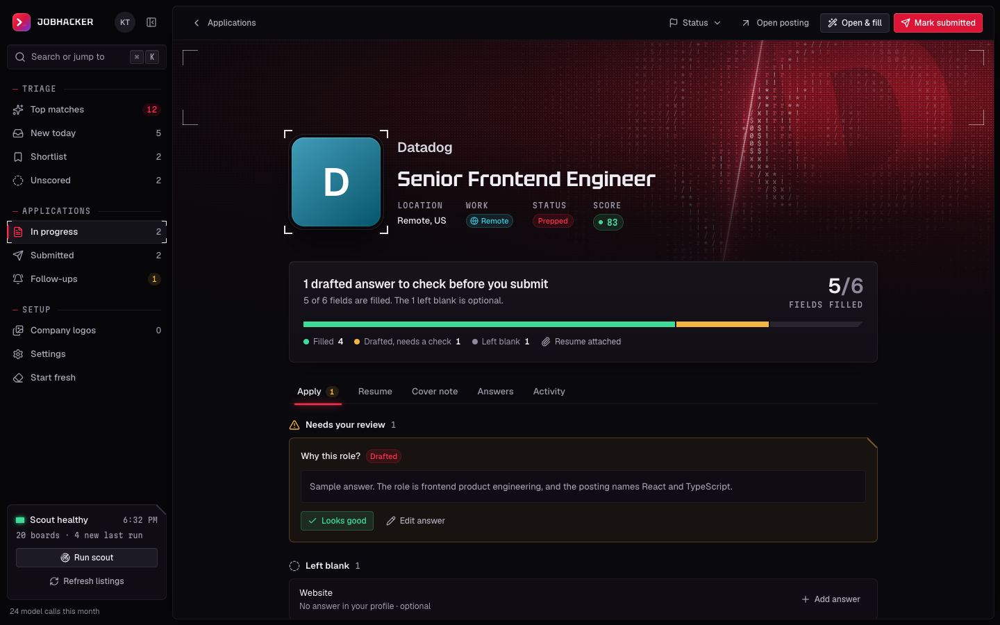
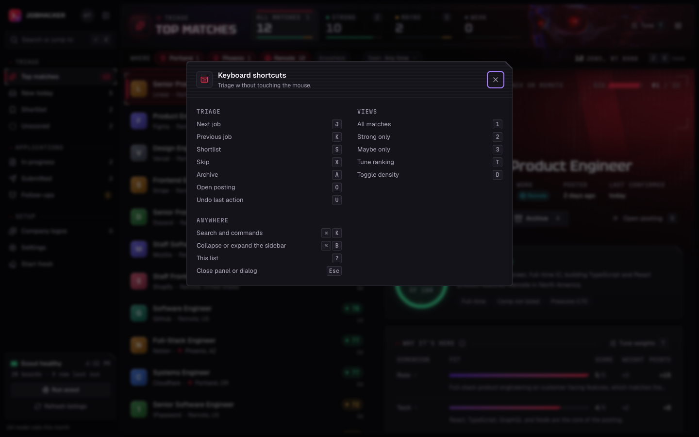

# Screenshots

The running app, with sample data: public companies and the fictional candidate in `config/profile.example.yaml`. The places in the filter are the example criteria. Marks in these frames are monograms. In ordinary use the browser loads the logo once a domain is known.

The triage view is also at the top of the README. Frames taken against a live database stay out of git.

## Triage

A ranked queue beside the selected job. The score and the reasons sit on the right. J and K move through the list, S shortlists, X skips.

## Where

Portland, Phoenix, and Remote are a view filter. This frame is Remote only, so the queue drops from 12 jobs to 10. The others stay stored.

## Tune the ranking

Drag a weight and the list re-ranks on this machine. No model call. Save writes the weights into `criteria.yaml`.

## Shortlist

Jobs you kept. Prepare application writes the materials for the selected one.

## Still unscored

Jobs the model has not reached. Prescore only decides which of them gets scored next. The four gates are the only things that remove a job, and this run removed none.

## Applications

Prepped, submitted, interviewing, offer. A form that still needs a look shows it on the row.

## Fill report

Open & fill writes the form in your Chrome and lists every field. A drafted answer waits here for a look. Mark submitted records that you sent it.

## Keyboard

`?` opens the shortcuts.

## On a phone

The same queue. The sidebar is behind the menu.

